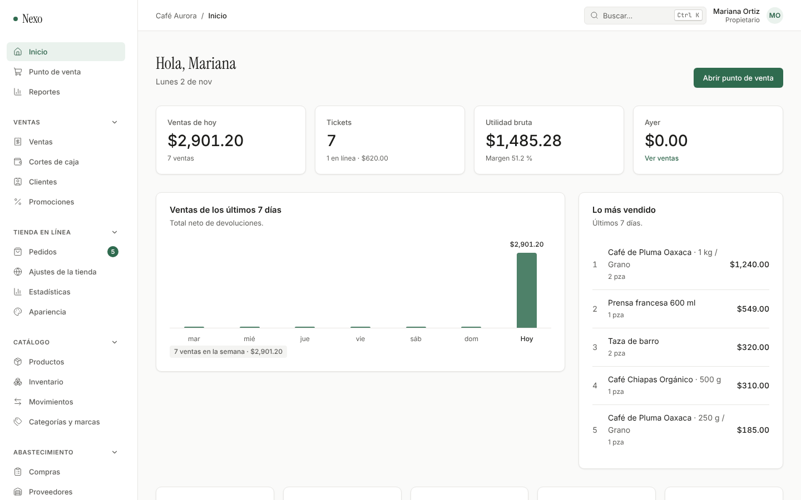
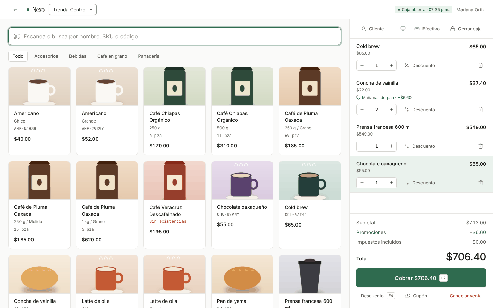
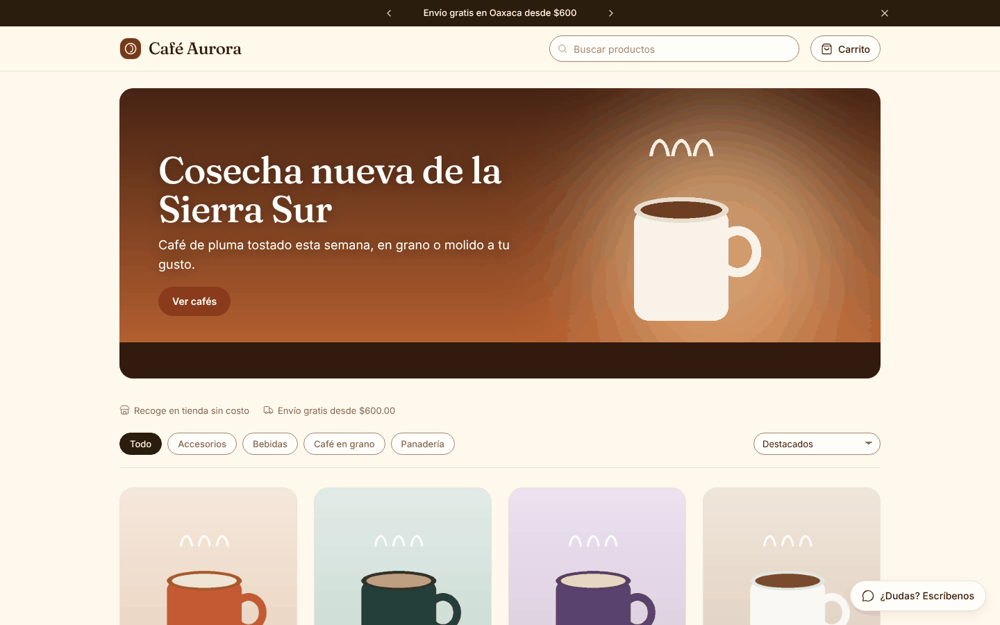
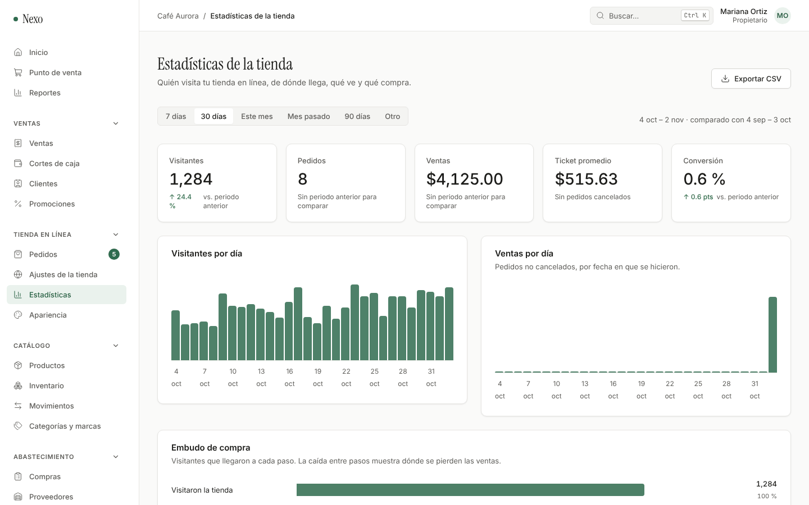
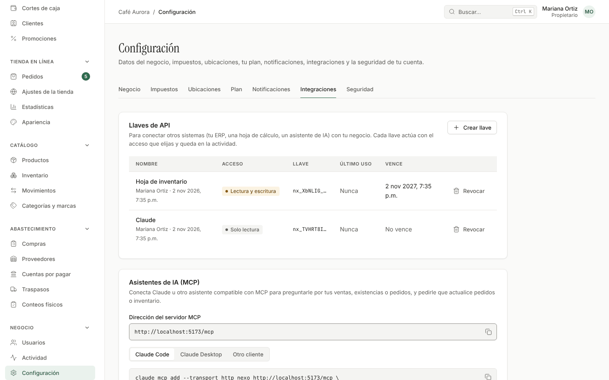
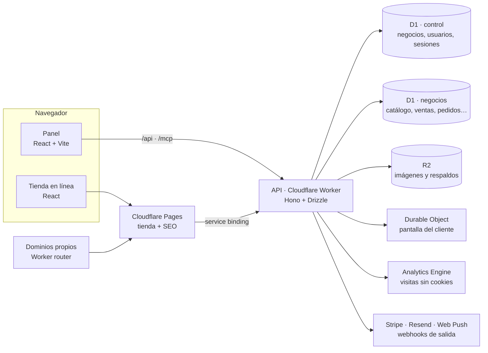

<div align="center">

# Nexo Commerce

**Punto de venta, inventario y tienda en línea para pequeños y medianos negocios, en un solo panel.**

Hecho para correr completo en Cloudflare: rápido en todo el mundo, sin servidores que mantener.

[Manual de usuario](docs/manual-de-usuario.md) · [Referencia técnica](docs/referencia-tecnica.md) · [Guía de despliegue](docs/despliegue.md)

</div>



---

## ¿Qué es Nexo?

Nexo reúne lo que un negocio necesita para vender en mostrador y en internet sin pelearse con varios sistemas: el catálogo y las existencias son uno solo, la caja y la tienda en línea nunca venden la misma última pieza, y los reportes juntan todo. Es multiempresa (cada negocio con sus datos aislados), tiene planes con suscripción y está en español de punta a punta.

<table>
  <tr>
    <td width="50%"><br><sub><b>Punto de venta</b> con escáner, atajos de teclado, pagos mixtos y pantalla para el cliente.</sub></td>
    <td width="50%"><br><sub><b>Tienda en línea</b> con existencias reales, temas, banners y pedidos que llegan al panel.</sub></td>
  </tr>
  <tr>
    <td width="50%"><br><sub><b>Estadísticas</b> de visitas sin cookies, embudo de compra y conversión.</sub></td>
    <td width="50%"><br><sub><b>Integraciones</b>: llaves de API, webhooks firmados y servidor MCP para asistentes de IA.</sub></td>
  </tr>
</table>

## Funciones

| Área | Lo que incluye |
|---|---|
| **Catálogo e inventario** | Productos con variantes, imágenes, SKU y código de barras, unidades a granel, importación desde Excel (CSV), existencias por ubicación, Kardex, costo promedio, conteos físicos a ciegas y traspasos entre sucursales. |
| **Punto de venta** | Caja para teclado y escáner, descuentos con límite por rol, promociones y cupones, pagos mixtos con cambio, cierre de caja ciego, ingresos y retiros, recibo térmico o por correo, anulaciones y devoluciones, y pantalla para el cliente (segundo monitor o tablet). |
| **Abastecimiento** | Proveedores, órdenes de compra con recepciones parciales, sugerencias de reorden y cuentas por pagar. |
| **Tienda en línea** | Catálogo público con existencias reales, carrito, recoger en tienda o envío, pago al recibir, transferencia o tarjeta (Stripe), seguimiento del pedido, políticas con aceptación, SEO, sitemaps y `llms.txt`, dominio propio, temas, banners, barra de avisos y píxeles de anuncios. |
| **Clientes y reportes** | Clientes con historial en caja y en línea, ventas y utilidad por periodo, inventario valorizado y estadísticas de la tienda con fuentes, campañas y embudo. |
| **Operación** | Usuarios con roles (propietario, administrador, cajero), actividad auditada, notificaciones push, panel instalable en el celular, buscador `Ctrl + K` y respaldos diarios. |
| **Plataforma** | Planes con límites y suscripción en Stripe, cobro con tarjeta por negocio (Stripe Connect), suspensión de cuentas y traslado de un negocio a otra base de datos. |
| **Integraciones** | API REST con llaves por negocio, webhooks firmados con reintentos y servidor **MCP** para que Claude u otros asistentes consulten y operen el negocio. |

## Cómo está hecho



- **Un solo Worker** sirve la API y el panel en el mismo dominio (la sesión no necesita CORS) y corre las tareas programadas: respaldos, pedidos vencidos, resumen de la mañana y reintentos de webhooks.
- **Todo cambio y su auditoría se guardan juntos** en un lote atómico de D1. Las existencias no pueden quedar negativas ni con dos ventas simultáneas, y los folios no tienen huecos.
- **Un solo motor de precios** (`@nexo/shared`) corre en la caja, en la tienda y en el servidor: lo que el cliente ve es lo que se cobra.
- **Dinero en centavos, cantidades en milésimas**: sin errores de redondeo.

**Tecnologías:** TypeScript · Cloudflare Workers, D1, R2, Pages, Durable Objects y Analytics Engine · Hono · Drizzle ORM · React 19 · Vite · Zod · Vitest · Playwright.

Los detalles (reglas de datos, cada módulo, seguridad y la API completa) están en la [referencia técnica](docs/referencia-tecnica.md).

## Empezar

Necesitas **Node 22** (ver `.nvmrc`) y npm. No hace falta una cuenta de Cloudflare para desarrollar: `wrangler dev` simula D1 y R2 en tu computadora.

```bash
npm install
npm run build -w @nexo/ui   # compila los tokens de diseño
npm run dev                 # migra la base local y levanta la API, el panel y la tienda
```

| Servicio | Dirección |
|---|---|
| Panel | http://localhost:5173 |
| API | http://localhost:8787 |
| Tienda | http://localhost:5174/&lt;tu-negocio&gt; |

Abre el panel, crea tu negocio y activa la tienda en **Tienda en línea → Ajustes de la tienda**. En desarrollo, los correos (por ejemplo, recuperar la contraseña) se imprimen en la consola de la API.

### Comandos

| Comando | Qué hace |
|---|---|
| `npm run dev` | Migra la base local y levanta API, panel y tienda |
| `npm run typecheck` | Revisa los tipos de todo el proyecto |
| `npm test` | Pruebas unitarias |
| `npm run smoke` | Pruebas de punta a punta contra la API en marcha |
| `npm run build` | Compila tokens, panel y tienda |
| `npm run db:generate` | Genera migraciones a partir del esquema |
| `npm run db:migrate:local` | Aplica las migraciones a la base local |
| `npm run deploy:staging` · `deploy:production` | Compila, migra y publica en Cloudflare |
| `node scripts/vapid-keys.mjs` | Genera las llaves de las notificaciones push |

## Estructura

```
apps/
  api/        API (Cloudflare Worker con Hono). También sirve el panel compilado.
  admin/      Panel de administración (React + Vite).
  store/      Tienda en línea (Cloudflare Pages) y el router de dominios propios.
packages/
  db/         Esquema de Drizzle y migraciones de las dos bases D1.
  shared/     Lógica y tipos compartidos: precios, permisos, validaciones, SEO, temas…
  ui/         Sistema de diseño: tokens, estilos y componentes.
scripts/      Pruebas de punta a punta y utilidades.
docs/         Manual de usuario, referencia técnica y guía de despliegue.
```

## Calidad

- **134 pruebas unitarias** (precios, impuestos, promociones, temas, cifrado de Web Push, firmas de webhooks…).
- **12 suites de punta a punta** con **669 comprobaciones** sobre la API real: ventas y devoluciones concurrentes, carreras por la última pieza, suscripciones y pagos con Stripe simulado, dominios, notificaciones push descifradas como lo haría el navegador, webhooks con verificación de firma y el servidor MCP probado con el SDK oficial.
- GitHub Actions revisa tipos, ejecuta las pruebas y compila en cada pull request, y despliega a staging en cada push a `main`.

## Despliegue

Nexo se publica en Cloudflare con un comando por entorno, después de crear las bases D1, el bucket R2 y el proyecto de Pages. La [guía de despliegue](docs/despliegue.md) explica cada paso, las variables y secretos, y la configuración opcional de Stripe, dominios propios, notificaciones y estadísticas.

## Estado

Las fases 0 a 11 del plan están terminadas: fundamentos, catálogo e inventario, punto de venta, abastecimiento, tienda en línea, crecimiento, SaaS, SEO y políticas, operación diaria, apariencia, estadísticas e integraciones.

Pendiente antes de producción: activar el correo (Resend), Stripe y los dominios propios en staging. La facturación electrónica (CFDI) está fuera del alcance actual. El detalle está en la [guía de despliegue](docs/despliegue.md#pendiente-antes-de-producción).

## Documentación

| Documento | Para quién |
|---|---|
| [Manual de usuario](docs/manual-de-usuario.md) | Dueños, administradores y cajeros: cómo usar el panel, paso a paso |
| [Referencia técnica](docs/referencia-tecnica.md) | Desarrolladores: arquitectura, reglas de datos, módulos, seguridad y API |
| [Guía de despliegue](docs/despliegue.md) | Quien publica y opera la plataforma en Cloudflare |
