# Manual de usuario · Panel de Nexo

Guía para dueños, administradores y cajeros. Explica cómo hacer cada tarea en el panel, paso a paso.

> Las imágenes son de un negocio de ejemplo, *Café Aurora*. Lo que ves en tu panel depende de tu rol y de tu plan.

---

## Contenido

1. [Primeros pasos](#1-primeros-pasos)
2. [Configura tu negocio](#2-configura-tu-negocio)
3. [Productos y catálogo](#3-productos-y-catálogo)
4. [Inventario](#4-inventario)
5. [Punto de venta y caja](#5-punto-de-venta-y-caja)
6. [Ventas, devoluciones y anulaciones](#6-ventas-devoluciones-y-anulaciones)
7. [Clientes y promociones](#7-clientes-y-promociones)
8. [Compras, proveedores y cuentas por pagar](#8-compras-proveedores-y-cuentas-por-pagar)
9. [Tienda en línea](#9-tienda-en-línea)
10. [Pedidos en línea](#10-pedidos-en-línea)
11. [Reportes y estadísticas](#11-reportes-y-estadísticas)
12. [Notificaciones y el panel en tu celular](#12-notificaciones-y-el-panel-en-tu-celular)
13. [Integraciones: API, webhooks y asistentes de IA](#13-integraciones-api-webhooks-y-asistentes-de-ia)
14. [Seguridad y actividad](#14-seguridad-y-actividad)
15. [Preguntas frecuentes](#15-preguntas-frecuentes)
16. [Glosario](#16-glosario)

---

## 1. Primeros pasos

### Crea tu cuenta

1. Entra a la dirección de Nexo y elige **Crea tu negocio**.
2. Escribe el nombre de tu negocio, tu nombre, tu correo y una contraseña de al menos 10 caracteres.
3. Listo: entras como **Propietario** del negocio, en el plan Gratis.

¿Olvidaste tu contraseña? En la pantalla de ingreso elige **¿Olvidaste tu contraseña?** y te enviaremos un enlace por correo. El enlace sirve una sola vez y vence en 60 minutos.

### Conoce el panel

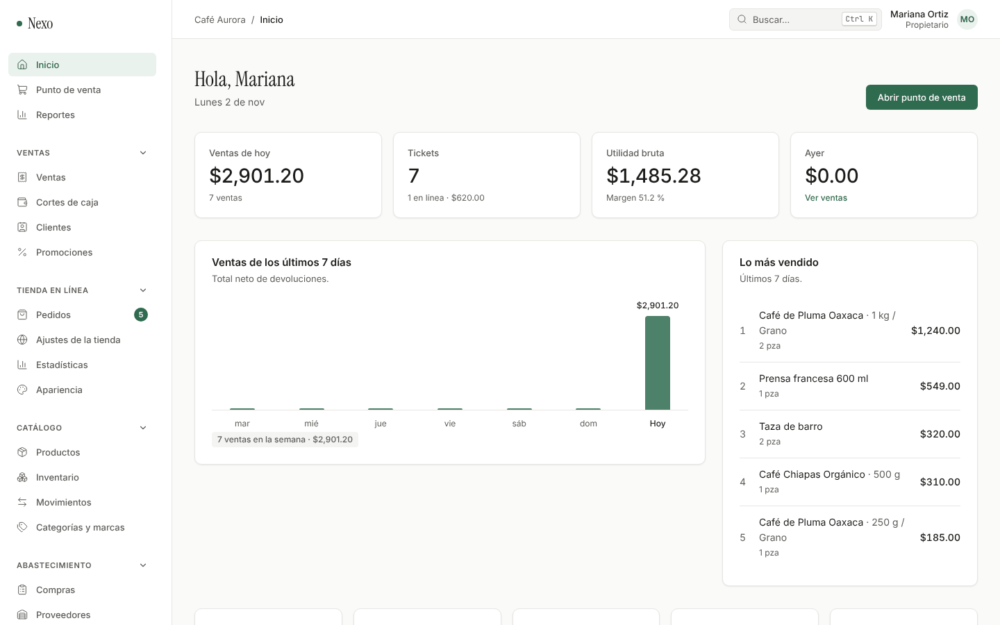

- **Inicio** muestra lo que vendiste hoy, la comparación con ayer, la gráfica de la semana, lo más vendido, las cajas abiertas y los pedidos en línea por atender.
- **Menú lateral**: agrupa las secciones (Ventas, Tienda en línea, Catálogo, Abastecimiento, Negocio). Haz clic en el título de una sección para plegarla o desplegarla. Si pliegas la sección donde estás, la página actual sigue visible. Si pliegas *Tienda en línea* y hay pedidos nuevos, el contador aparece junto al título.
- **Barra superior**: el nombre de la página, el buscador y tu usuario.
- **Ayuda** (abajo en el menú) abre este manual dentro del panel, con buscador. El ícono **?** de la barra superior te lleva directo a la parte del manual de la página donde estás.

### El buscador (Ctrl + K)

Presiona **Ctrl + K** (o **⌘ K** en Mac), o haz clic en **Buscar…**, y escribe lo que necesitas:

- **Páginas y acciones**, aunque no escribas el nombre exacto: «corte», «iva», «kardex», «nuevo producto», «cambiar contraseña».
- **Productos, clientes, pedidos y proveedores**: por nombre, SKU, código de barras o número de pedido.

Usa **↑ ↓** para moverte, **Enter** para abrir y **Esc** para cerrar. Solo aparecen las cosas que tu rol puede abrir.

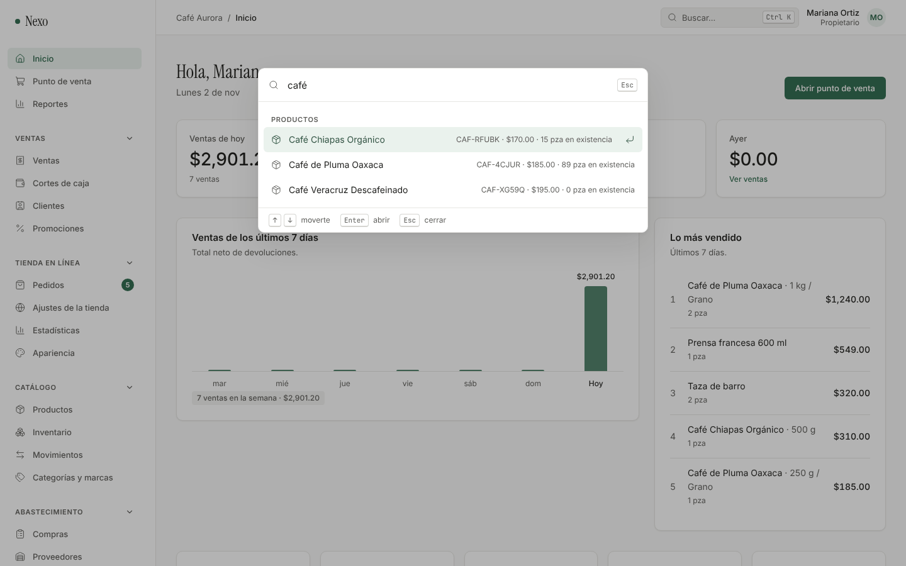

### Roles: quién puede hacer qué

| | Propietario | Administrador | Cajero |
|---|:---:|:---:|:---:|
| Vender en caja, abrir y cerrar su turno | ✓ | ✓ | ✓ |
| Ver catálogo y existencias | ✓ | ✓ | ✓ |
| Atender pedidos en línea | ✓ | ✓ | ✓ (sin cancelar) |
| Registrar clientes | ✓ | ✓ | ✓ |
| Ver costos, utilidad y reportes | ✓ | ✓ | — |
| Editar productos, precios e inventario | ✓ | ✓ | — |
| Anular ventas y hacer devoluciones | ✓ | ✓ | — |
| Compras, proveedores y cuentas por pagar | ✓ | ✓ | — |
| Usuarios, tienda en línea e integraciones | ✓ | ✓ | — |
| Plan, suscripción y cuenta de Stripe | ✓ | — | — |

El cajero tiene además un **límite de descuento** (10 % por defecto) y hace los cortes y los conteos **a ciegas**: cuenta sin ver lo que el sistema espera.

---

## 2. Configura tu negocio

Todo está en **Configuración** (al final del menú).

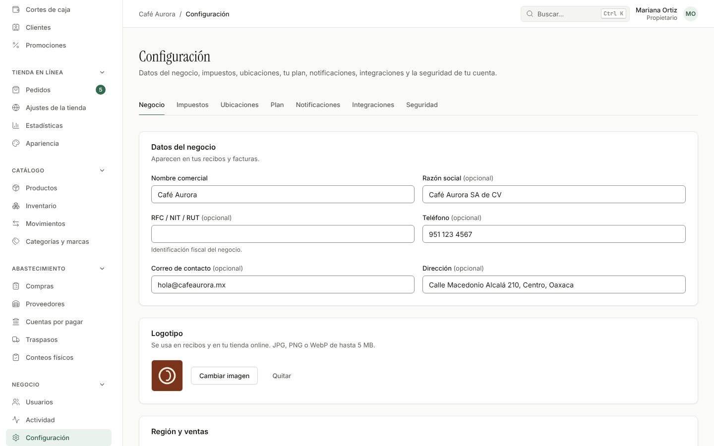

| Pestaña | Qué hay |
|---|---|
| **Negocio** | Nombre comercial, razón social, RFC, teléfono, correo, dirección y **logotipo** (sale en recibos y en la tienda). También la moneda, la zona horaria, si tus precios **incluyen impuestos** y el límite de descuento del cajero. |
| **Impuestos** | Tus tasas (por ejemplo IVA 16 % o 0 %) y cuál es la predeterminada. Cada producto puede usar otra. |
| **Ubicaciones** | Tiendas, sucursales y bodegas. Cada una tiene sus propias existencias y su propia caja. |
| **Plan** | Tu plan, lo que usas de él y el cambio de plan (solo el propietario). |
| **Notificaciones** | Avisos en tu celular o computadora (ver [sección 12](#12-notificaciones-y-el-panel-en-tu-celular)). |
| **Integraciones** | Llaves de API, webhooks y asistentes de IA (ver [sección 13](#13-integraciones-api-webhooks-y-asistentes-de-ia)). |
| **Seguridad** | Cambiar tu contraseña. Al cambiarla se cierran tus sesiones en otros dispositivos. |

### Usuarios

En **Usuarios** invitas a tu equipo:

1. **Nuevo usuario** → nombre, correo, contraseña inicial y rol.
2. Para cambiar el rol, elige otro en la lista.
3. **Desactivar** quita el acceso al instante y cierra sus sesiones. Su historial se conserva.

**Roles y permisos.** Nexo trae tres roles: **Propietario** (todo, incluido el plan y los pagos), **Administrador** (todo menos el plan y los pagos) y **Cajero** (vende en la caja con corte a ciegas, atiende pedidos y consulta el catálogo). Si necesitas algo intermedio, crea tus propios roles en **Usuarios → Roles y permisos**:

1. **Nuevo rol** (o **Copiar** desde Administrador o Cajero) → nombre y descripción.
2. Marca lo que puede hacer, agrupado por áreas: punto de venta y caja, catálogo e inventario, abastecimiento, tienda en línea, clientes y promociones, y negocio. Por ejemplo, un **Almacenista** con inventario, compras y traspasos, pero sin ver ventas ni costos.
3. Asigna el rol a cada persona desde la lista de **Personas**.

Los cambios a un rol se aplican al instante a quien lo tenga. Nadie puede dar permisos que él mismo no tiene, ni cambiar a alguien con más permisos que él. Un rol que alguien tiene no se puede eliminar: primero cambia a esas personas de rol.

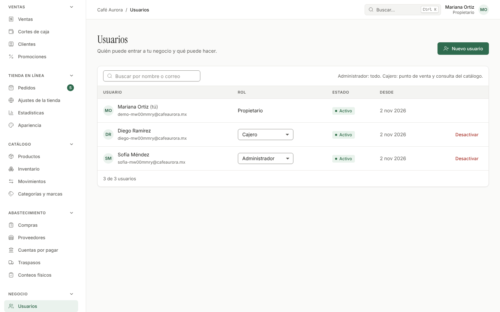

### Planes

| | Gratis | Pro | Negocio |
|---|---|---|---|
| Ubicaciones | 1 | 3 | 20 |
| Usuarios | 2 | 10 | Sin límite |
| Productos | 100 | 5 000 | Sin límite |
| Cobro con tarjeta en la tienda | — | ✓ | ✓ |
| Dominio propio y HTML/JS en la tienda | — | ✓ | ✓ |
| Llaves de API / webhooks | 2 / 1 | 10 / 10 | Sin límite |

Bajar de plan no borra nada: solo impide agregar más de lo que el plan permite.

---

## 3. Productos y catálogo

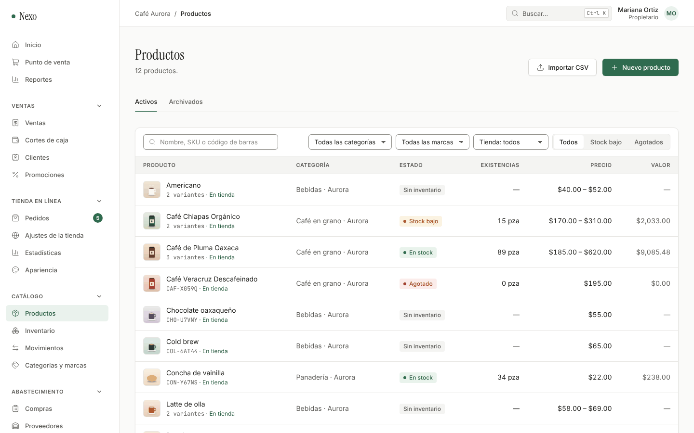

En **Productos** ves todo tu catálogo con su estado de existencias, su precio y el valor del inventario. Puedes filtrar por categoría, marca, si está en la tienda en línea y por existencias (*Stock bajo*, *Agotados*).

### Crear un producto

1. **Nuevo producto**.
2. **Información general**: nombre y descripción (la descripción se muestra en la tienda en línea).
3. **Imágenes**: hasta 8 (JPG, PNG o WebP de hasta 5 MB). La primera es la principal; haz clic en otra para hacerla principal.
4. **Organización**: categoría, marca e impuesto.
5. **Inventario**: unidad de venta (pieza, kg, litro, caja…) y si **controla inventario**. Desmárcalo para lo que no se cuenta, como un café preparado o un servicio.
6. **Precio y variantes**: precio, costo, SKU, código de barras y **mínimo** (cuando las existencias llegan al mínimo, el producto sale como *Stock bajo*).
7. Opcional: **Mostrar en la tienda en línea** y su título y descripción para buscadores.
8. **Guardar**.

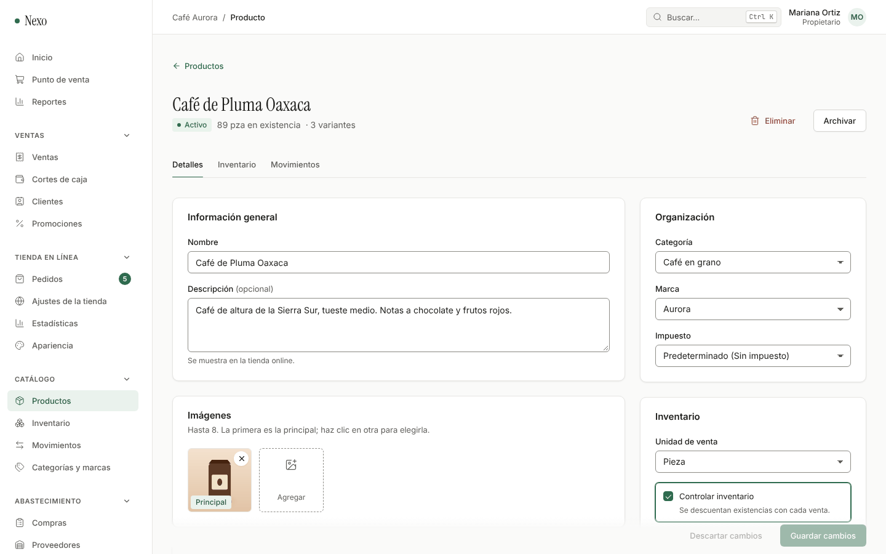

### Variantes (tallas, tamaños, colores…)

Si un producto viene en varias presentaciones, agrega **opciones** (hasta 3, por ejemplo *Tamaño* y *Molienda*) con sus valores. Nexo crea una variante por cada combinación, y cada una tiene su propio precio, SKU, código de barras y existencias. Los botones **Precio**, **Costo** y **Mínimo** copian un valor a todas las variantes.

> El SKU se genera solo si lo dejas vacío. El SKU y el código de barras no se pueden repetir dentro de tu negocio.

### Importar desde Excel (CSV)

**Productos → Importar CSV**. Descarga la plantilla desde el mismo diálogo, llénala en Excel y guárdala como CSV. Las filas con el mismo nombre se agrupan como variantes. Las categorías, marcas e impuestos que no existan se crean solos. Si alguna fila tiene un error, te decimos en qué fila está.

### Archivar o eliminar

- **Archivar** oculta el producto de la caja y de la tienda, pero conserva su historial. Lo recuperas en la pestaña *Archivados*.
- **Eliminar** solo se puede si no tiene existencias.

### Categorías y marcas

En **Categorías y marcas** creas, renombras y eliminas las categorías y marcas. Las categorías también sirven de filtros en la caja y en la tienda.

---

## 4. Inventario

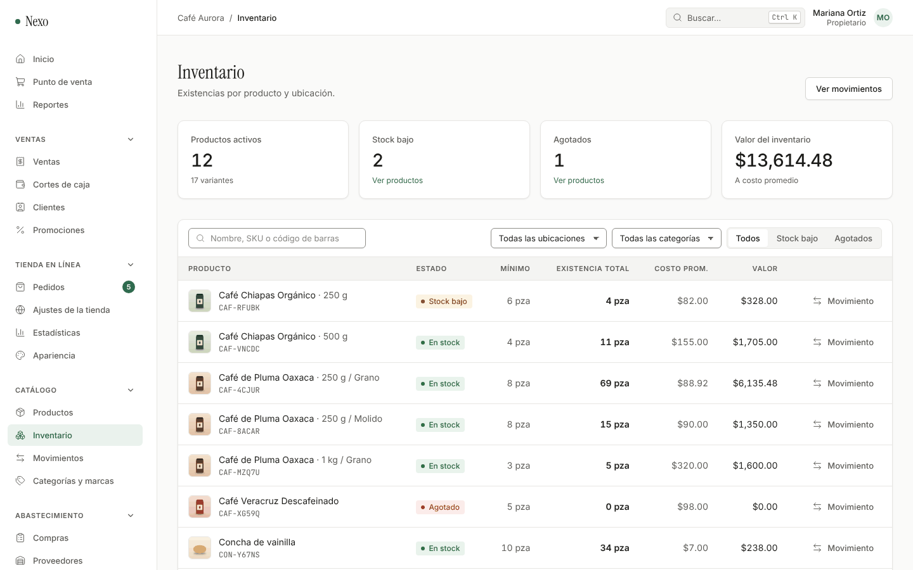

**Inventario** muestra las existencias por producto y ubicación, el costo promedio y el valor. Arriba ves cuántos productos tienen stock bajo, cuántos están agotados y cuánto vale tu inventario.

### Ajustar existencias

Desde **Inventario**, en la fila del producto elige **Movimiento**:

- **Entrada**: compra, devolución de cliente, sobrante u otro. Si escribes el costo, se recalcula el **costo promedio**.
- **Salida**: merma, caducado, robo, uso interno, devolución a proveedor u otro.
- **Conteo**: escribe lo que contaste y Nexo ajusta la diferencia.

Las existencias nunca se editan «a mano»: todo cambio queda registrado en los movimientos.

### Movimientos (Kardex)

**Movimientos** es el historial de cada entrada y salida, con quién la hizo, por qué y con cuánto quedó la existencia. Puedes filtrar por producto, ubicación o tipo.

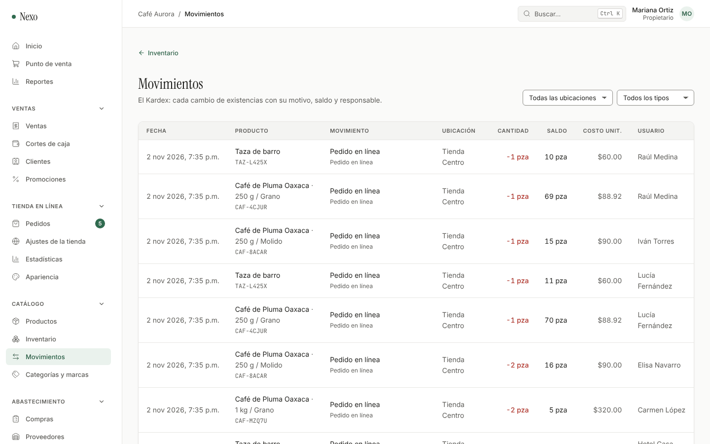

### Conteos físicos

Para contar todo el inventario, una categoría o algunos productos:

1. **Conteos físicos → Nuevo conteo** → elige la ubicación y qué contar → **Empezar conteo**.
2. Tu equipo captura lo que cuenta (con el escáner o escribiendo). El cajero cuenta **a ciegas**.
3. El administrador revisa las diferencias y elige **Aplicar conteo**.

Puedes seguir vendiendo durante el conteo: el ajuste toma en cuenta lo que se vendió mientras tanto.

### Traspasos entre ubicaciones

1. **Traspasos → Nuevo traspaso** → elige el origen, el destino y los productos.
2. Al **enviar**, la mercancía sale del origen.
3. En el destino, alguien elige **Confirmar llegada** e indica lo que realmente llegó. Si falta algo, la diferencia queda registrada.

Si cancelas un traspaso en camino, todo regresa al origen.

---

## 5. Punto de venta y caja

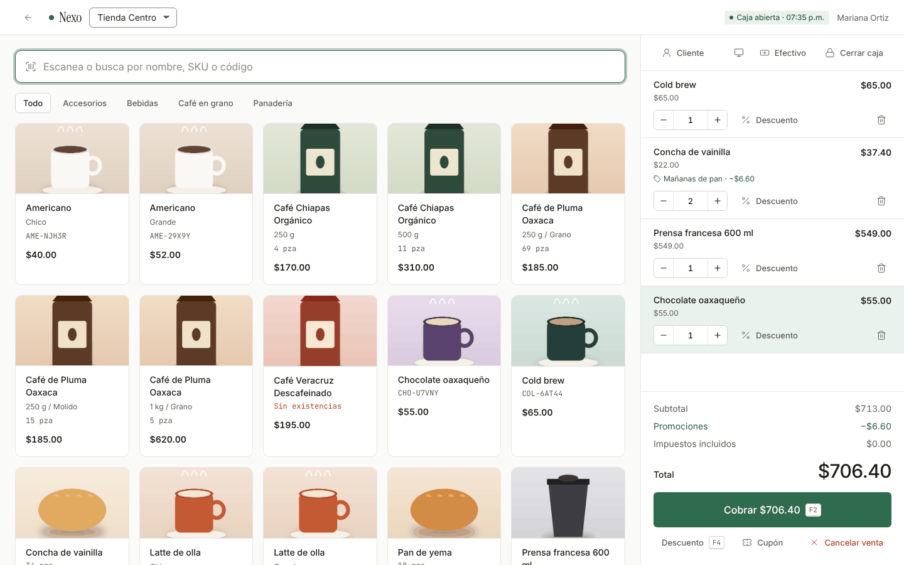

### Abrir la caja

1. **Punto de venta** (o **Abrir punto de venta** en Inicio).
2. Si tienes varias ubicaciones, elige en cuál estás.
3. **Abrir caja** → escribe el **fondo** (el efectivo con el que empiezas).

Cada ubicación tiene una sola caja abierta a la vez.

### Vender

- **Escanea** el código de barras o **escribe** el nombre o SKU y presiona **Enter**. También puedes tocar el producto en la cuadrícula.
- Cambia la cantidad con **+ / −** o escribiéndola. Los productos a granel aceptan decimales (por ejemplo 1.25 kg).
- **Descuento** en una línea o en toda la venta (**F4**). El cajero tiene un límite.
- Las **promociones** se aplican solas y verás cuánto ahorra el cliente.
- **Cliente**: búscalo o regístralo en el momento, para que la venta quede en su historial.
- **Cupón**: escribe el código.

### Cobrar

1. **Cobrar** (**F2**).
2. Elige la forma de pago: **Efectivo**, **Tarjeta**, **Transferencia** u **Otro**. Puedes combinar varias.
3. En efectivo, escribe lo recibido o toca un billete sugerido: Nexo calcula el **cambio**.
4. **Cobrar** (**Enter**). Puedes imprimir el recibo, enviarlo por correo o empezar la siguiente venta.

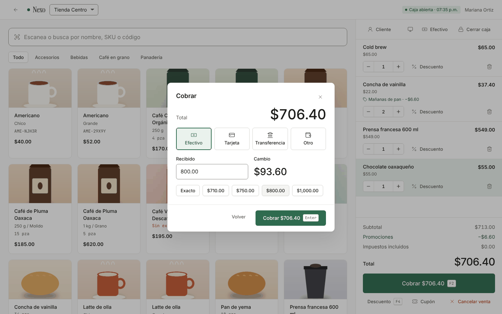

> Si se corta el internet mientras cobras, vuelve a intentarlo sin miedo: la misma venta nunca se cobra dos veces.

### Atajos del teclado

| Tecla | Acción |
|---|---|
| **Enter** | Agrega lo escaneado o buscado / confirma el cobro |
| **F2** | Cobrar |
| **F4** | Descuento a toda la venta |
| **+ / −** | Cambia la cantidad de la línea seleccionada |
| **Esc** | Vuelve a la búsqueda |

### Pantalla para el cliente

Tu cliente puede ver lo que vas escaneando, el total y su cambio. Toca el botón de **monitor** en la caja:

- **Segundo monitor** de la misma computadora: **Abrir pantalla del cliente**, arrastra la ventana al monitor del cliente y ponla en pantalla completa.
- **Tablet o TV**: **Conectar otro dispositivo**. En la tablet abre `…/pantalla` y escribe el código de 6 dígitos que te muestra la caja. No necesita iniciar sesión, se reconecta sola y recuerda el código. **Terminar emparejamiento** la desconecta.

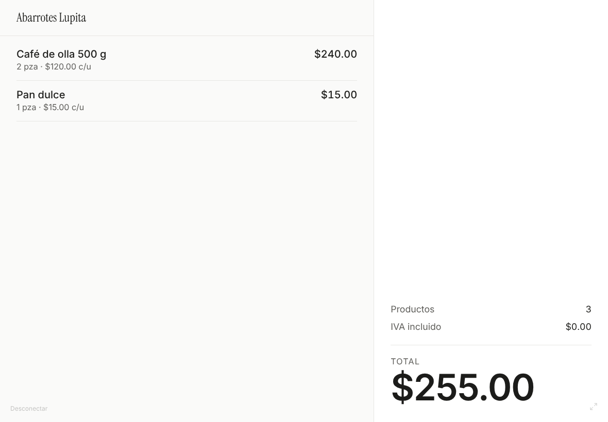

### Ingresos, retiros y corte de caja

- **Efectivo** (en la barra de la caja): registra **ingresos** (por ejemplo, más cambio) y **retiros** (por ejemplo, un pago o el dinero que se lleva el dueño), con su motivo.
- **Cerrar caja**: cuenta el efectivo y escríbelo **antes** de ver el esperado (*cierre ciego*). Nexo muestra la diferencia: sobrante o faltante.

En **Cortes de caja** ves cada turno con su fondo, sus ventas, sus movimientos y su diferencia.

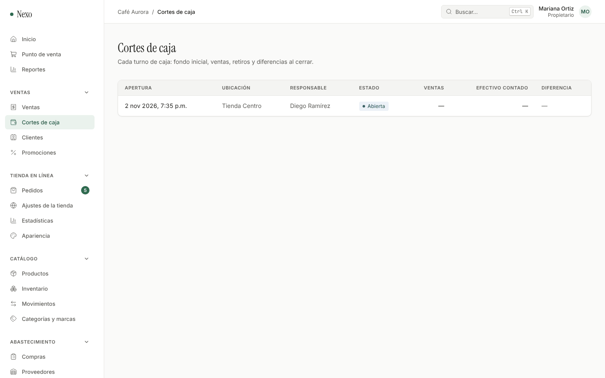

---

## 6. Ventas, devoluciones y anulaciones

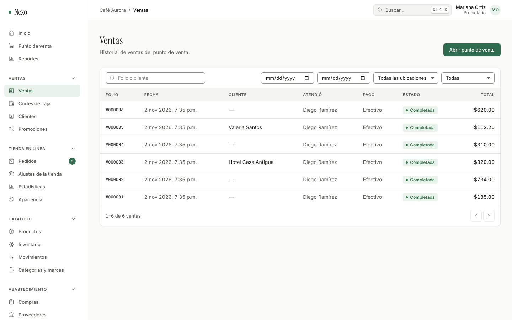

**Ventas** es el historial, con folio, fecha, cliente, quién atendió, forma de pago y total. Ábrela para ver el detalle, **imprimir** el recibo o **enviarlo por correo**.

- **Anular venta**: solo mientras la caja de ese turno siga abierta. La venta deja de contar y las existencias regresan. Debes indicar el motivo.
- **Devolución**: total o parcial, en cualquier momento. Eliges qué productos regresan al inventario y cómo reembolsas (en efectivo, la caja debe estar abierta).

Las anulaciones y devoluciones son para propietarios y administradores.

---

## 7. Clientes y promociones

### Clientes

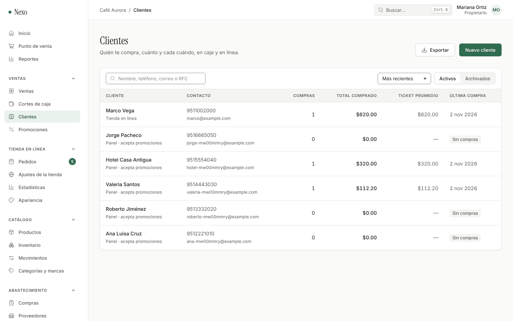

Los clientes se registran en **Clientes**, al cobrar en la caja, solos cuando hacen un pedido en la tienda en línea (se reconocen por su correo o su teléfono) o cuando **crean su cuenta** en la tienda. Los que tienen cuenta llevan la etiqueta **Cuenta en la tienda**. Su ficha junta las compras en caja y en línea, el total gastado, el ticket promedio, la última compra y lo que más compra. **Exportar** descarga la lista en CSV.

### Promociones y cupones

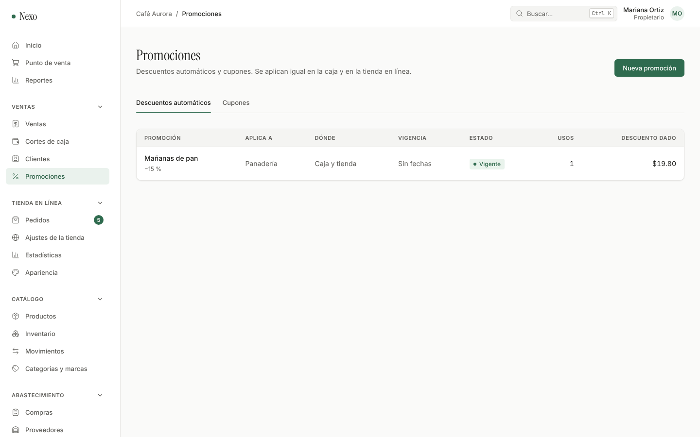

- **Nueva promoción**: un porcentaje de descuento para todo, para algunas categorías o para algunos productos, con fechas y canal (*caja*, *tienda en línea* o *ambos*). Se aplican solas. Si un producto tiene varias promociones, gana la mejor.
- **Nuevo cupón**: un código (por ejemplo `BIENVENIDA`) con porcentaje o importe, compra mínima, usos máximos, fechas y canal.

Los precios con promoción son iguales en la caja y en la tienda en línea.

---

## 8. Compras, proveedores y cuentas por pagar

### Proveedores

En **Proveedores** guardas los datos de contacto y los **días de crédito** de cada uno. Con ellos se calcula cuándo vence cada factura.

### Órdenes de compra

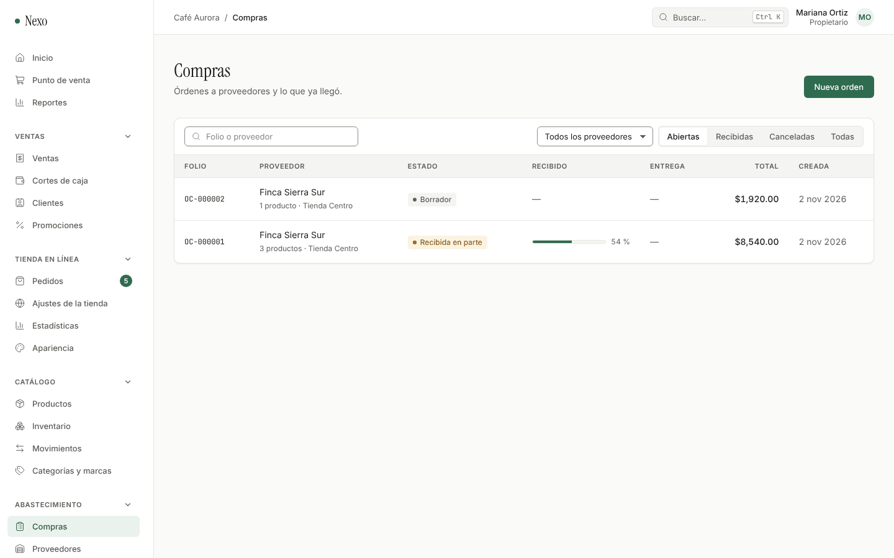

1. **Compras → Nueva orden** → proveedor, ubicación y productos con su costo. **Agregar productos con stock bajo** llena la orden con lo que se está acabando.
2. **Guardar borrador** o **Guardar y marcar como pedida**. Puedes enviarla por correo al proveedor.
3. Cuando llega la mercancía: **Recibir mercancía**. Puedes recibir todo o una parte, con el **costo real de la factura**. Las existencias suben y se recalcula el costo promedio.
4. Si el proveedor no surtirá lo que falta: **Cerrar con pendientes**.

**Repetir** crea una orden igual a otra anterior.

### Cuentas por pagar

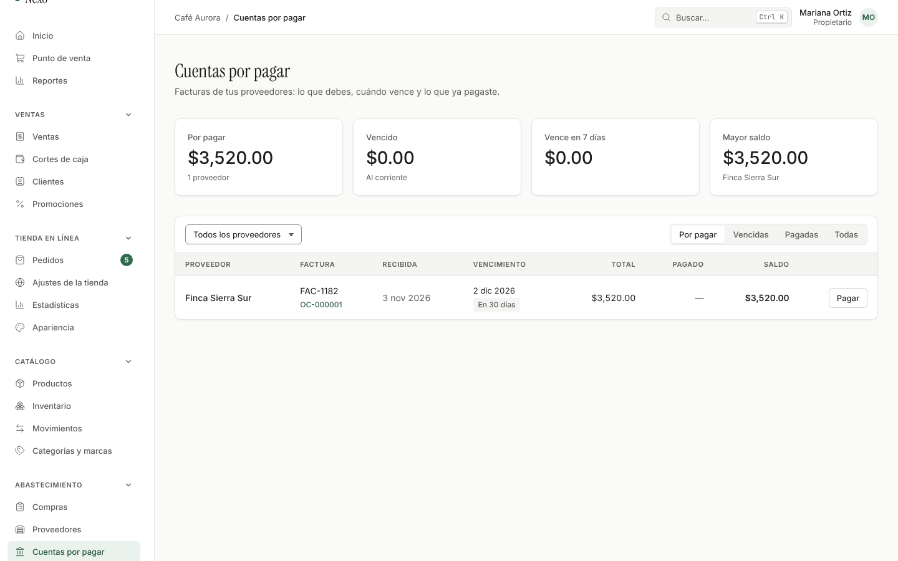

Cada recepción de mercancía se convierte en una factura por pagar, con su fecha de vencimiento. Registra pagos totales o parciales. Si pagas en efectivo desde la caja, el pago queda como retiro en el corte.

---

## 9. Tienda en línea

Tu catálogo en internet, con las existencias reales de la ubicación que elijas. Los pedidos llegan al panel.

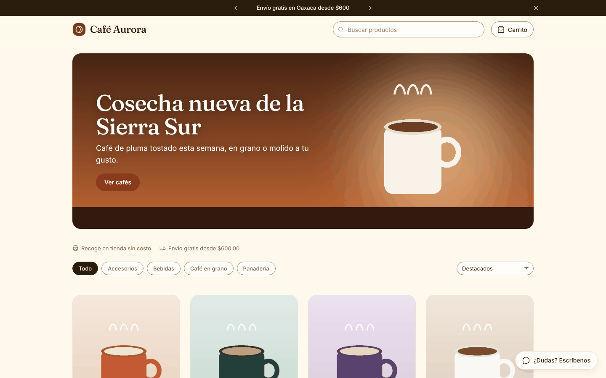

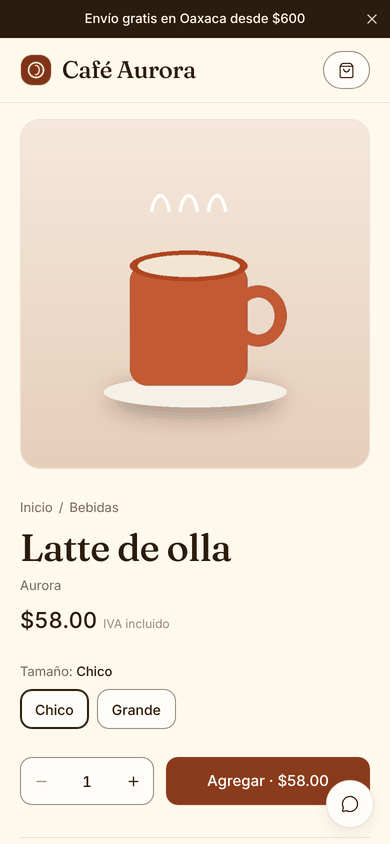

### Activarla

**Ajustes de la tienda**:

1. **Estado**: activa la tienda y elige la ubicación que surte los pedidos. Arriba ves la dirección de tu tienda y el botón para copiarla.
2. **Entrega**: recoger en tienda (con instrucciones) o envío a domicilio (costo, envío gratis desde cierto monto, zona y compra mínima).
3. **Formas de pago**: pago al recibir, transferencia (con tus datos bancarios) y tarjeta (Stripe, desde el plan Pro).
4. **Productos publicados**: publica u oculta todos de una vez, o uno por uno desde cada producto.
5. **Contacto y avisos**: WhatsApp de la tienda, el correo que recibe los pedidos nuevos y después de cuántas horas se liberan los pedidos sin aceptar (se cancelan solos y devuelven sus existencias).

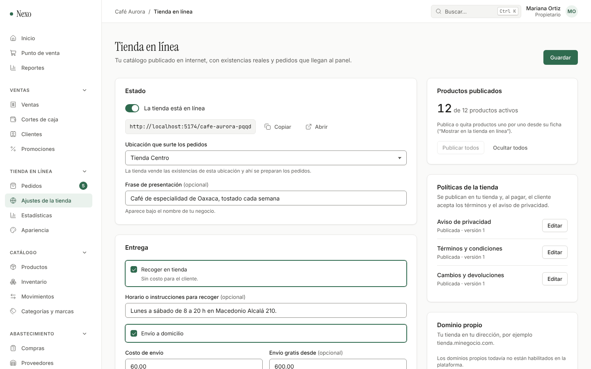

### Cuentas de clientes

Tus clientes pueden crear una cuenta en la tienda con su nombre, correo y contraseña (el botón **Entrar** arriba a la derecha). Con ella ven **Mis pedidos**, guardan su teléfono y su dirección, y compran más rápido. Cada cuenta es solo de tu tienda.

- **Navegar y llenar el carrito no pide cuenta.** Al pagar, si no han entrado, la tienda les pide **entrar o crear su cuenta** ahí mismo, sin perder el carrito.
- Al registrarse aparecen en **Clientes**. Si ya existía un cliente con ese correo (por ejemplo, de la caja), se liga a él sin cambiar lo que ya tenías.
- En **Mis pedidos** solo ven los pedidos que hicieron con su cuenta.
- Si olvidan su contraseña, usan **¿Olvidaste tu contraseña?** y reciben un enlace por correo.
- Para dejar que también compren como invitados, desmarca **Pedir cuenta para comprar** en **Ajustes de la tienda → Cuentas de clientes**.

### Cobrar con tarjeta (Stripe)

En **Ajustes de la tienda → Formas de pago → Conectar con Stripe**, el propietario conecta la cuenta de Stripe del negocio. El dinero le llega directo. Después activa **Tarjeta**.

### Políticas, buscadores y preguntas frecuentes

- **Políticas de la tienda**: aviso de privacidad, términos y condiciones, y cambios y devoluciones. Cada una parte de una plantilla con tus datos (revísala con tu asesor). Cuando están publicadas, el cliente debe aceptarlas antes de pagar.
- **Buscadores y asistentes de IA**: el título y la descripción con que tu tienda aparece en Google (con vista previa) y la opción de ocultarla de los buscadores.
- **Preguntas frecuentes**: se muestran en la tienda y ayudan a que Google y los asistentes de IA citen tu tienda.

### Dominio propio (plan Pro)

**Ajustes de la tienda → Dominio propio** → escribe tu dominio (por ejemplo `tienda.tunegocio.com`) → agrega en tu proveedor de dominio los registros que te mostramos → **Comprobar ahora**. Cuando esté activo, tu tienda abre en ese dominio.

### Apariencia

**Tienda en línea → Apariencia**, con vista previa en computadora y celular:

- **Tema**: elige un estilo (Nexo, Boutique, Fresco, Minimal, Mercado, Nocturno) y, si quieres, tus colores, la letra de los títulos y las esquinas. Te avisamos si algún color se lee mal.
- **Barra de avisos**: hasta 3 mensajes arriba de la tienda (envío gratis, horarios, un cupón), con fechas.
- **Banners**: hasta 6 imágenes grandes que se van alternando, con título, botón y enlace. Medida recomendada: 2100 × 800 px; para celular, 1080 × 1350 px.
- **Píxeles**: Meta (Facebook e Instagram), Google y TikTok para medir tus anuncios. La tienda pide permiso de cookies al cliente antes de activarlos.
- **Código**: CSS propio; HTML y JavaScript con plan Pro en tu dominio propio.

Al terminar, presiona **Guardar cambios**. También puedes pedirle estos cambios a un asistente de IA (ver [Asistentes de IA](#asistentes-de-ia-mcp)).

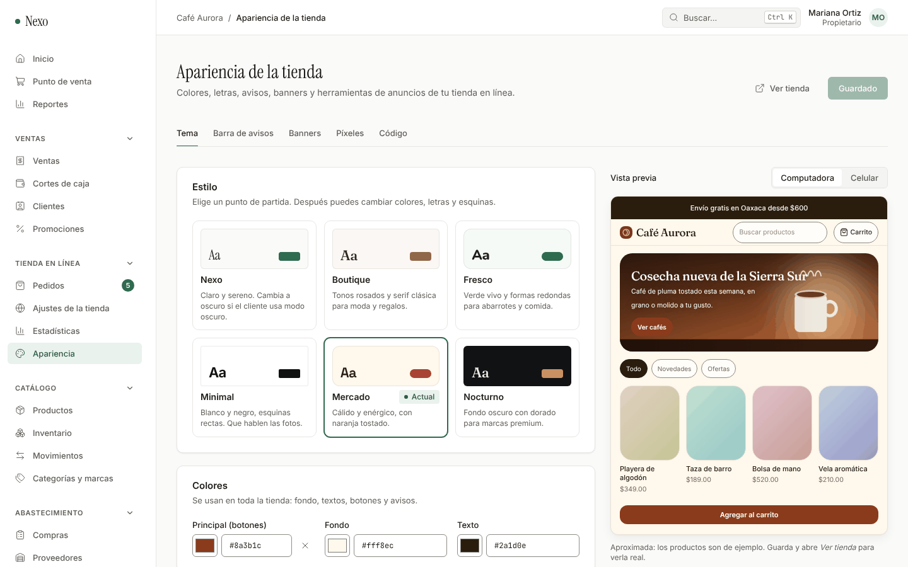

---

## 10. Pedidos en línea

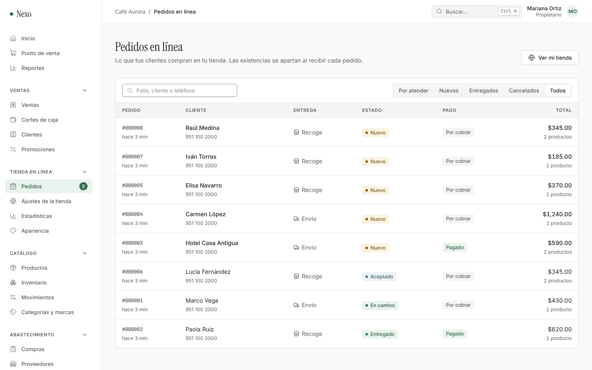

Los pedidos nuevos aparecen con un contador en el menú. Si activaste las notificaciones, también te llega un aviso.

**Ciclo de un pedido:** Nuevo → Aceptado → Listo para recoger / En camino → Entregado. El cliente recibe un correo en cada paso y puede seguir su pedido con un enlace.

1. Abre el pedido y revisa los productos, el cliente y la entrega.
2. **Aceptar pedido** cuando empieces a prepararlo.
3. **Listo** cuando ya se puede recoger o va en camino.
4. **Entregado** al entregarlo. Si no estaba pagado, indica cómo pagó. El efectivo entra a la caja abierta.

**Registrar pago** sirve para marcar una transferencia recibida antes de entregar. **Cancelar pedido** (solo administradores) regresa las existencias. Desde el pedido puedes escribirle al cliente por WhatsApp, llamarle o enviarle un correo.

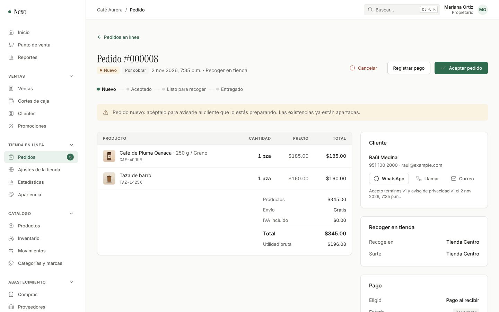

> Las existencias se **apartan** en cuanto llega el pedido: la caja y la tienda nunca venden la misma última pieza. Los pedidos nuevos y sin pagar se cancelan solos después de las horas que configuraste (48 por defecto).

---

## 11. Reportes y estadísticas

### Reportes

**Reportes → Ventas**: elige el periodo (hoy, ayer, 7 o 30 días, este mes, el mes pasado u otro) y ves:

- Ventas netas, tickets, utilidad bruta (sin impuestos) y descuentos, comparados con el periodo anterior.
- Ventas por día, por categoría, por forma de pago, por cajero y por hora.
- Productos vendidos (exportables a CSV) y cupones usados.

**Reportes → Inventario**: el valor del inventario por categoría y los productos sin movimiento.

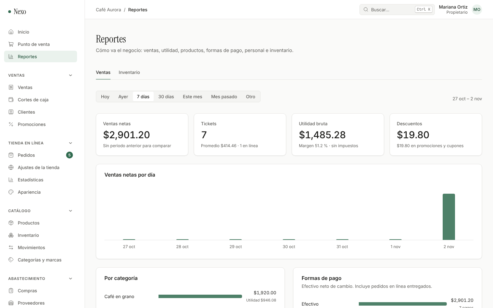

### Estadísticas de la tienda

**Tienda en línea → Estadísticas**: periodos de hasta 90 días, comparados con el periodo anterior.

- **Visitantes, pedidos, ventas, ticket promedio y conversión** (pedidos por cada visitante).
- **Embudo de compra**: cuántos visitaron, vieron un producto, agregaron al carrito, empezaron a pagar e hicieron pedido. Así ves en qué paso se pierden las ventas.
- **De dónde llegan**: Google, Instagram, Facebook, WhatsApp, ChatGPT… o directo.
- **Campañas**: agrega `?utm_source=instagram&utm_campaign=otono` a los enlaces que compartes para medirlos aquí.
- Dispositivos, países, páginas, productos más vistos y más vendidos, formas de pago, entrega y clientes nuevos o recurrentes.

Las visitas se cuentan **sin cookies**. Los pedidos y las ventas siempre son exactos.

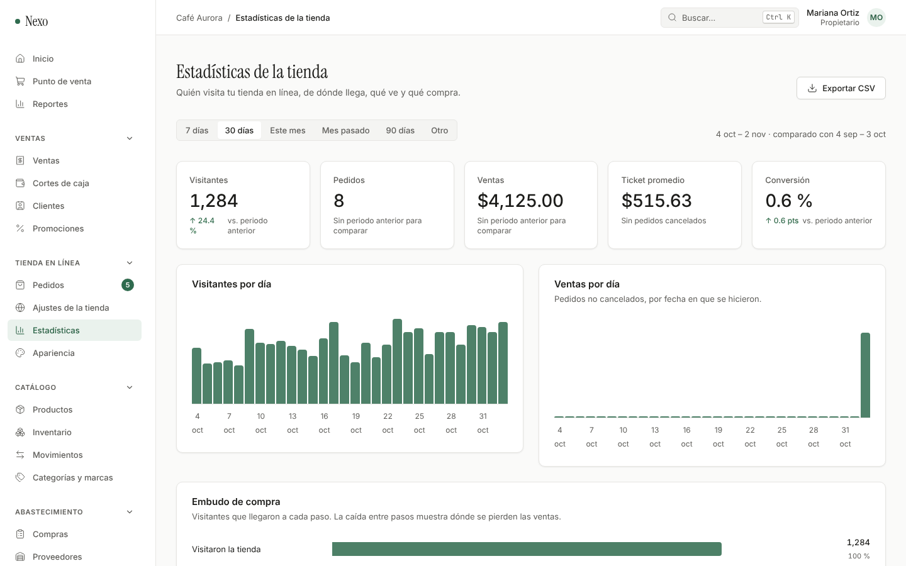

---

## 12. Notificaciones y el panel en tu celular

### Instalar el panel como app

- **En Android y en computadora (Chrome o Edge)**: abre el panel y elige **Instalar** en la barra de direcciones o en el menú del navegador.
- **En iPhone o iPad (iOS 16.4 o posterior)**: en Safari toca **Compartir → Agregar a inicio** y abre el panel desde ese ícono.

### Activar notificaciones

**Configuración → Notificaciones → Activar en este dispositivo** y acepta el permiso del navegador. Hazlo en cada dispositivo donde quieras recibir avisos. Después elige cuáles quieres:

- **Pedido nuevo en la tienda**
- **Pago con tarjeta recibido**
- **Resumen de la mañana** (a las 8:00: productos por resurtir y facturas por vencer)
- **Avisos de tu suscripción** (solo el propietario)

**Enviar prueba** confirma que funciona. Al tocar un aviso se abre la pantalla correspondiente.

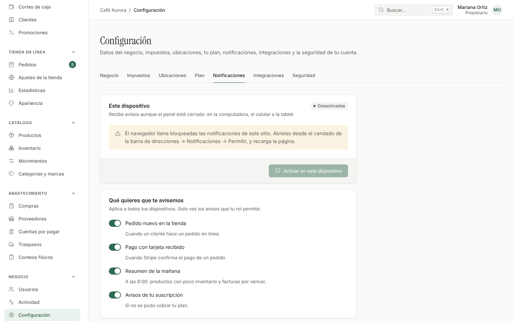

---

## 13. Integraciones: API, webhooks y asistentes de IA

**Configuración → Integraciones** (propietario y administradores).

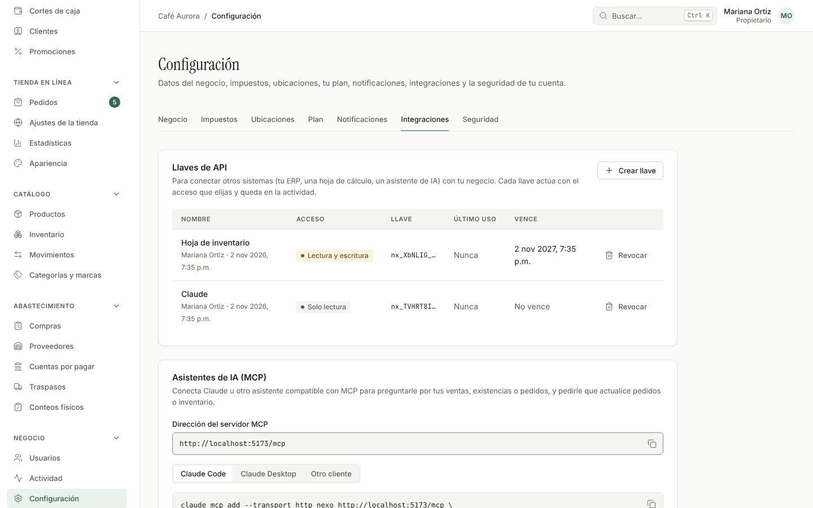

### Llaves de API

Sirven para conectar otros sistemas (tu ERP, una hoja de cálculo, Zapier) o un asistente de IA.

1. **Crear llave** → ponle un nombre y elige el acceso:
   - **Solo lectura**: consulta, pero no cambia nada.
   - **Lectura y escritura**: como un administrador.
   - **Caja**: como un cajero.
2. Copia la llave: **solo se muestra una vez**.
3. **Revocar** la desactiva al instante.

Ninguna llave puede ver usuarios, tu plan ni las integraciones. Lo que haga una llave aparece en la *Actividad* como «API · nombre».

### Asistentes de IA (MCP)

Conecta Claude u otro asistente compatible con MCP para preguntarle, por ejemplo, «¿cuánto vendí esta semana?», «¿qué tengo que resurtir?» o «¿qué pedidos están pendientes?». Con una llave de escritura también puede aceptar o entregar pedidos y ajustar existencias, y te pedirá confirmación antes de hacerlo. El panel te da el comando para Claude Code y la configuración para Claude Desktop, listos para copiar.

**Apariencia de la tienda.** El asistente también puede ver y cambiar lo mismo que la pantalla **Tienda en línea → Apariencia**:

| Puedes pedirle | Ejemplo |
|---|---|
| Ver la apariencia actual | «¿Qué tema y banners tiene mi tienda?» |
| Cambiar el tema | «Pon el estilo Boutique con la letra Moderna y esquinas redondas.» Si un color se lee mal, te avisa. |
| La barra de avisos | «Activa un aviso de "Envío gratis desde $999" hasta el 31 de diciembre.» |
| Los banners que ya subiste | «Oculta el segundo banner», «cambia el título del banner de otoño», «pon el de herramientas primero». Las imágenes nuevas se suben desde el panel. |
| El código personalizado | «Muéstrame el CSS de la tienda», «haz los botones más redondos con CSS», «agrega este script de chat antes de `</body>`». |

El CSS se puede editar en cualquier plan. El HTML y el JavaScript necesitan el plan **Pro** y solo corren en tu dominio propio, igual que en el panel. Como un error en el código puede romper la tienda, el asistente te muestra el código y te pide confirmación antes de guardarlo. Cada cambio queda en **Actividad** con el nombre de la llave.

> Para empezar, usa una llave de **Solo lectura**.

### Webhooks

Avisan al instante a otro sistema cuando pasa algo: un pedido nuevo, un pedido pagado, un cambio de estado, una venta, una anulación o devolución, un cambio en un producto o un ajuste de existencias.

1. **Agregar webhook** → la dirección `https://` que te dio el otro sistema → elige los eventos.
2. **Probar** envía un aviso de prueba.
3. **Entregas** muestra el historial: qué se envió, si llegó y cuántos intentos llevó. Desde ahí puedes **Reenviar**.

Si el otro sistema no responde, reintentamos durante un día. Cada aviso va **firmado** con el secreto del webhook. El panel trae un ejemplo de cómo verificar la firma.

---

## 14. Seguridad y actividad

- **Actividad**: el registro de quién hizo qué y cuándo (ventas anuladas, cambios de precio, ajustes de inventario, usuarios, integraciones…).
- **Contraseña**: tras 5 intentos fallidos, la cuenta se bloquea 15 minutos. Cambiar la contraseña cierra tus otras sesiones.
- **Respaldos**: se hacen automáticamente todos los días.

### Soporte de Nexo

Si algo no funciona, tienes una duda o quieres sugerir algo, escríbenos desde **Soporte**, abajo en el menú (propietarios y administradores).

1. Presiona **Nuevo ticket**, escribe el asunto, elige el tipo y cuéntanos qué pasa. Si algo falla, di qué hiciste, qué esperabas y qué pasó; el folio de la venta o el pedido ayuda mucho.
2. Si quieres, marca **Permitir que soporte entre a mi cuenta para revisar este ticket**. Lo puedes activar o quitar después, dentro del ticket.
3. Te respondemos en el mismo ticket y por correo. Cuando hay una respuesta, **Soporte** muestra un número en el menú.
4. Si ya se resolvió, presiona **Ya se resolvió, cerrar**. Si escribes en un ticket cerrado, se vuelve a abrir.

| Estado | Qué significa |
|---|---|
| **En revisión** | Lo estamos viendo. |
| **Respondido** | Te contestamos: revisa la respuesta. |
| **Cerrado** | Ya se resolvió. |

**Cuando soporte entra a tu cuenta**, lo hace como propietario durante una hora como máximo. Arriba del panel se ve una franja negra **Modo soporte** con el nombre de quién está, y todo lo que haga queda en **Actividad** a nombre de «Soporte Nexo». Soporte nunca puede cambiar tu plan y pagos, tus usuarios, tus llaves de API ni tu contraseña.

---

## 15. Preguntas frecuentes

**No puedo agregar más productos, usuarios o ubicaciones.**
Llegaste al límite de tu plan. Revisa *Configuración → Plan*.

**Un producto aparece «Sin existencias» en la caja.**
Registra una entrada en *Inventario*. Si es algo que no se cuenta (una bebida preparada, un servicio), desmarca **Controlar inventario** en el producto.

**La caja dice que no hay suficiente existencia.**
Nexo no deja vender más de lo que hay en esa ubicación. Revisa la existencia en *Inventario* o haz un traspaso desde otra ubicación.

**¿Cómo corrijo una venta?**
Si la caja de ese turno sigue abierta: *Ventas → la venta → Anular venta*. Si ya se cerró: haz una **Devolución**.

**El cliente no ve un producto en la tienda.**
Revisa que el producto esté activo, marcado **Mostrar en la tienda en línea** y con existencias en la ubicación que surte la tienda.

**No me llegan las notificaciones.**
Revisa que el navegador tenga permiso (el candado de la barra de direcciones → *Notificaciones*). En iPhone, el panel debe estar agregado a la pantalla de inicio.

**Mi cuenta dice que está desactivada.**
El equipo de Nexo la desactivó. Escríbenos desde otra cuenta del negocio (*Soporte*) o al correo de soporte.

**¿Puedo vender sin internet?**
No. La caja necesita conexión para garantizar que las existencias y los folios siempre cuadren.

---

## 16. Glosario

| Término | Significado |
|---|---|
| **Variante** | Una presentación de un producto (talla, tamaño, color) con su propio precio y existencias. |
| **SKU** | Clave interna del producto. |
| **Kardex** | El historial de entradas y salidas del inventario. |
| **Costo promedio** | El costo de cada pieza, recalculado con cada compra. |
| **Mínimo** | La existencia a partir de la cual un producto sale como *Stock bajo*. |
| **Fondo** | El efectivo con el que se abre la caja. |
| **Cierre ciego** | Contar el efectivo sin ver antes lo que el sistema espera. |
| **Ticket promedio** | Venta total entre número de ventas. |
| **Conversión** | Pedidos por cada visitante de la tienda en línea. |
| **Webhook** | Un aviso automático que Nexo envía a otro sistema cuando pasa algo. |
| **MCP** | El protocolo con el que los asistentes de IA se conectan a Nexo. |
